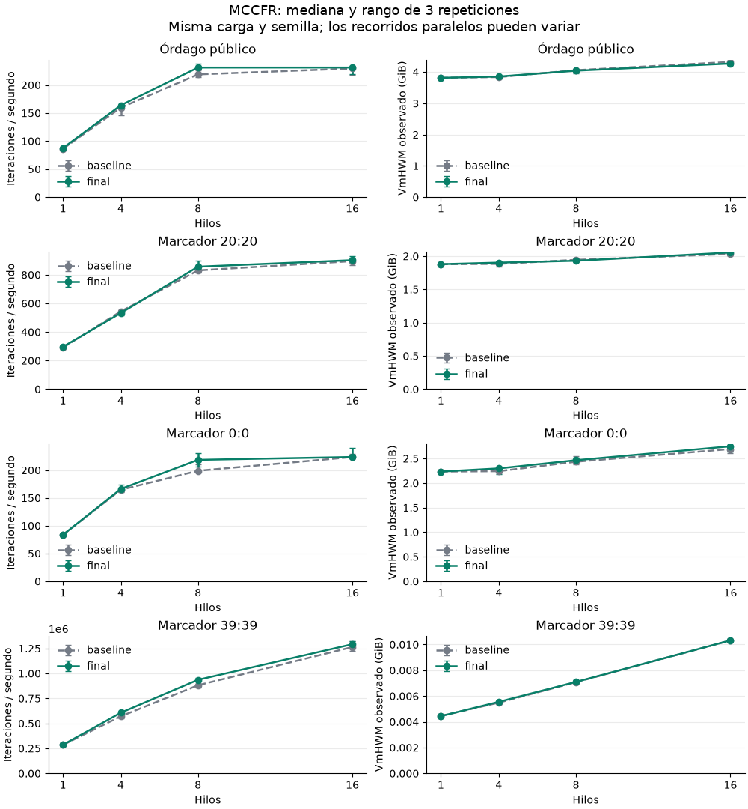

**Optimización MCCFR — cierre del 14 de septiembre de 2026**

Quedan tres mejoras en C-CFR, todas confirmadas en commits y enviadas inmediatamente al remoto. En la comparación final, las ganancias con ocho hilos van del 3,1% al 9,9% según la carga. Con dieciséis hilos son menores: del 0,0% al 2,2% en la serie principal y aproximadamente del 4,9% al 5,3% en la serie de almacenes grandes. Son medianas observadas en este equipo; los rangos y las parejas individuales se conservan en los datos. Simulador-Mus permanece intacto.

Se midieron las versiones `mus.heads-up-single-hand.ordago-public/v1-muses-1` y `mus.ordago-score/v4`, con un mus y objetivo 40. La referencia es mus-solver `af90e636` con C-CFR `91d7d39e`; el código final es mus-solver `c53a3f8` con C-CFR `cfaf1cf`. Los commits posteriores de documentación e instrumentación no cambian ese código de entrenamiento.

El equipo es un AMD Ryzen AI 7 350, con ocho núcleos físicos, dieciséis CPU lógicas y unos 30 GiB de RAM. Se usaron GCC 16.1.1, Linux 7.1.3 y los mismos flags `-O3 -flto -g`, sin `-march=native` ni cambios de aritmética. Los ejecutables se congelaron antes de medir. [Entorno](environment.json).

La serie principal contiene 96 ejecuciones: dos versiones, cuatro cargas, 1/4/8/16 hilos y tres repeticiones. Cada proceso empieza con un almacén vacío, sin reserva explícita, y semilla 7. Se alternan versiones y órdenes de hilos. El tiempo C incluye preparación concurrente y creación/unión de trabajadores; excluye evaluación y persistencia. Las continuaciones sintéticas son `V[a][b]=(a-b)/40`.

| Carga | Iteraciones | Hilos | Antes, iter/s | Final, iter/s | Variación | RSS final, GiB |
|---|---:|---:|---:|---:|---:|---:|
| Órdago público | 2.000 | 8 | 219,0 | 231,2 | +5,6% | 4,05 |
| Órdago público | 2.000 | 16 | 229,5 | 231,2 | +0,8% | 4,28 |
| Marcador 20:20 | 6.000 | 8 | 830,9 | 856,6 | +3,1% | 1,93 |
| Marcador 20:20 | 6.000 | 16 | 895,5 | 902,3 | +0,8% | 2,05 |
| Marcador 0:0 | 1.000 | 8 | 198,9 | 218,5 | +9,9% | 2,49 |
| Marcador 0:0 | 1.000 | 16 | 223,6 | 223,7 | +0,0% | 2,75 |
| Marcador 39:39 | 3.000.000 | 8 | 881.435,3 | 936.210,0 | +6,2% | 0,0071 |
| Marcador 39:39 | 3.000.000 | 16 | 1.264.389,0 | 1.292.598,1 | +2,2% | 0,0103 |

La curva completa incluye el control con un hilo y los rangos mínimo/máximo, que no son intervalos de confianza. En las doce parejas con un hilo coinciden exactamente nodos visitados, infosets, recorridos, iteraciones y contadores del almacén. En paralelo, las actualizaciones cambian el recorrido: se conservan también nodos/s e infosets y no se interpreta cada iteración como una cantidad fija de trabajo.



[Gráfico vectorial](scaling.svg). En órdago público, ocho y dieciséis hilos dan unas 231 iteraciones/s. La mediana de CPU consumida es 7,39 frente a 13,24 CPU lógicas equivalentes, y el RSS mediano es 4,05 frente a 4,28 GiB. Para esa carga, ocho hilos ofrecen una mejor relación entre throughput y recursos.

La comprobación ampliada contiene otras 24 ejecuciones, con tres repeticiones por versión, carga e hilos. Aumenta el estado aprendido hasta alrededor de 7,5 GiB de RSS:

| Carga | Iteraciones | Hilos | Antes, iter/s | Final, iter/s | Variación | RSS final, GiB |
|---|---:|---:|---:|---:|---:|---:|
| Órdago público | 5.000 | 8 | 248,5 | 256,1 | +3,1% | 7,22 |
| Órdago público | 5.000 | 16 | 253,9 | 267,3 | +5,3% | 7,50 |
| Marcador 0:0 | 3.000 | 8 | 242,2 | 249,9 | +3,1% | 4,85 |
| Marcador 0:0 | 3.000 | 16 | 239,0 | 250,6 | +4,9% | 5,32 |

La CLI se comprobó con continuaciones reales: región `35:35`, 25 celdas, 10.000 iteraciones y 10.000 muestras por celda, tres repeticiones y directorios nuevos. Sus doce ejecuciones incluyen evaluación, unos 52 MB de checkpoints comprimidos por proceso, publicación de valores, recarga y otra evaluación de 10.000 muestras. Se validaron las 300 celdas y los 300 checkpoints esperados.

| Celdas × hilos/celda | Tiempo anterior → final | Iter/s final del proceso | Variación | RSS final |
|---|---:|---:|---:|---:|
| 2 × 4 | 6.036 → 6.011 s | 41.593,8 | +0,4% | 112.2 MiB |
| 4 × 2 | 6.720 → 6.398 s | 39.072,5 | +5,0% | 118.3 MiB |

El caso 2×4 queda cerca del empate: la mediana de cocientes emparejados es −0,5%. En 4×2 es +2,6%, frente al +5,0% del cociente de medianas. Ambos cálculos están disponibles; no se extrapola ese 5% a todo entrenamiento de marcador.

En los 132 procesos finales no se observó swap del ejecutable en las muestras y no hubo fallos mayores de página ni bloques de entrada. El host sí expulsó 64,94 MiB a swap, sin entradas desde swap registradas; esos contadores globales no permiten asignar el origen al entrenamiento. Los 120 microentrenamientos registraron cero bloques de salida; las doce CLI escribieron 592,0 MiB en bloques de E/S, incluidos 619.012.768 bytes de checkpoints en total.

El RSS máximo de la versión final fue 7,519 GiB, frente a 7,566 GiB de la referencia; quedaron al menos 7,724 GiB disponibles. La memoria permanente por nodo no aumenta. Hay una salvedad instrumental: en 39:39, `ru_maxrss` conserva un máximo anterior a `exec` y presenta unos 320 MiB que no corresponden a la imagen actual del ejecutable. La tabla de ese caso y todo el gráfico usan `VmHWM` observado: aproximadamente 7,3 MiB con ocho hilos y 10,6 MiB con dieciséis. Los datos conservan ambas fuentes y el CSV identifica explícitamente `ru_maxrss`.

El sensor CPU Tctl alcanzó 92,750 °C en la referencia y 94,125 °C en la versión final. Este último pico ocurrió en 39:39, cuatro hilos, repetición dos; su presión CPU durante la ejecución fue 0,182% y la de memoria 0,00165%. La medida no demuestra que el cambio cause la diferencia térmica. En el conjunto final, la presión máxima CPU del host fue 20,75% y la de memoria 0,556%, esta última en una ejecución de referencia con almacén grande. Los sensores y frecuencias quedan registrados por separado.

El monitor consumió entre 0,155% y 1,805% de la CPU del proceso; con ocho/dieciséis hilos, entre 0,155% y 0,396%, y en la CLI entre 0,466% y 0,623%. Es consumo de CPU del monitor, no una medida directa de ralentización.

Los recursos del entrenamiento se obtienen de `getrusage` y, para la CLI completa, de `wait4`. El monitor muestrea `/proc` cada 0,2 segundos: CPU por hilo y procesador, RSS/swap, fallos de página, cambios de contexto, E/S, memoria disponible, PSI, frecuencias y temperaturas. La CPU por hilo es un límite inferior muestreado; los contadores del proceso incluyen todos los hilos. El escritorio siguió activo. Las medidas del host incluyen otras cargas; no se hicieron compilaciones ni otros entrenamientos a la vez que las comparaciones.

El perfilado inicial combinó gprofng, perf y anotación de ensamblador. En marcador 20:20 con ocho hilos, `concurrent_get_or_create` consumió aproximadamente el 29,5% de CPU exclusiva. En el perfil de dieciséis hilos, las pausas de reintento representaron aproximadamente el 22% de los ciclos totales muestreados. Esto dirigió el trabajo hacia búsquedas repetidas y contención. [Perfil inicial](baseline-profile.txt), [almacén](baseline-store-annotate.txt), [actualizaciones](baseline-trainer-annotate.txt).

La comprobación final con contadores hardware conserva cuatro ejecuciones adicionales. Los contadores de usuario cubren el proceso completo y se normalizan por nodos visitados. No tienen multiplexación (100% del tiempo habilitado):

| Carga | Ciclos/nodo anterior → final | Instrucciones/nodo anterior → final | Fallos de caché/nodo anterior → final |
|---|---:|---:|---:|
| Público, 5.000 iteraciones, 8 hilos | 1.159,47 → 1.155,76 | 1.051,19 → 1.034,67 | 9,765 → 9,378 |
| 20:20, 15.000 iteraciones, 16 hilos | 1.363,32 → 1.320,84 | 1.074,72 → 1.020,48 | 7,245 → 6,935 |

Son parejas auxiliares, no una campaña estadística: en público, esa ejecución final tuvo menos iteraciones/s (254,4 → 244,2) y casi los mismos nodos/s; en marcador pasó de 1.161,5 a 1.204,2 iteraciones/s. El informe conserva estos resultados aunque no todos favorezcan al cambio. [Contadores y resultados completos](profiles.json).

Los cambios conservados son:

- `977af31`: busca primero la copia privada de estrategia mediante la clave de información. Evita repetir accesos al almacén compartido dentro del mismo recorrido. Añade ocho bytes por copia temporal; no amplía cada nodo permanente.
- `5a07f4e`: publica la versión del nodo mediante cargas/escrituras atómicas bajo su bloqueo exclusivo. Conserva las barreras necesarias para las lecturas coherentes y evita dos operaciones atómicas de lectura-modificación-escritura por actualización.
- `cfaf1cf`: tras un conflicto devuelve los bloqueos adquiridos y consulta ese nodo antes de reintentar. Reduce adquisiciones fallidas del prefijo y mantiene la validación transaccional.

Todos están publicados en `origin/perf/mccfr-threading-20260914`. El solver incorpora cada uno mediante `4045805`, `da3c9f5` y `c53a3f8`. Los cambios de instrumentación están en `99fec30` y `5320224`.

Se cerraron once ensayos exploratorios con 426 ejecuciones. Los porcentajes de ensayos individuales no se suman para obtener la ganancia final:

| Variante | Ejecuciones | Decisión |
|---|---:|---|
| 64 particiones del almacén | 48 | Revertida: resultados mixtos; regresión de alrededor del 11% en 35:18/16 hilos |
| Liberación anticipada de nodos | 24 | Revertida: sin mejora consistente y pérdidas en 20:20 |
| Copias por clave | 48 | Conservada |
| Etiqueta con bits intermedios del hash | 36 | Revertida: no confirmó menor coste por nodo |
| Reparto dinámico de bloques | 48 | Revertida: la recreación de espacios de trabajo/cachés anuló el beneficio |
| Admisión global con espera activa | 27 | Revertida: menos throughput y mucho más tiempo de kernel |
| Publicación de versiones | 48 | Conservada |
| Admisión global con futex | 24 | Revertida: aproximadamente −7% a −15% en las cargas completadas |
| Copia parcial al deshacer apuestas | 27 | Revertida: aproximadamente −6% con 16 hilos en ambos juegos |
| Espera sobre el nodo conflictivo | 48 | Conservada |
| Alineación de nodos a 64 bytes | 48 | Revertida: +26–33% de RSS en tablas grandes sin ganancia suficiente |

Las series interrumpidas conservan solamente sus ejecuciones completadas; los datos identifican las parejas disponibles. El piloto no tiene muestreo externo. [Resumen de ensayos](experiments.csv), [datos compactos de los ensayos](experiments.json.gz).

Pasaron `make test` y `make test-sanitize` completos de mus-solver; las pruebas normales, de fallos de asignación, AddressSanitizer/UndefinedBehaviorSanitizer y ThreadSanitizer de C-CFR; y las validaciones de la CLI. Las regresiones añadidas cubren crecimiento y reinicio de snapshots, claves negativas/colisiones, correspondencia de acciones, RNG y acumuladores, errores transaccionales y lectura concurrente durante el desbordamiento del contador de versión. La prueba de estrés complementa la revisión del protocolo de memoria; GCC ThreadSanitizer no modela completamente las barreras atómicas. [Extractos de validación](validation.txt).

Simulador-Mus conserva `2fda65eb22995588f0eb7605cc77cf2d8c8882d5`, sin cambios de archivos ni del puntero de submódulo. Las mediciones describen throughput y recursos, no una mejora demostrada de convergencia o calidad de la estrategia.

Para reproducir, compile ambas versiones con las mismas reglas y use el harness actual contra sus respectivas bibliotecas. La referencia antigua no contiene este harness: copie `tests/benchmark_training.c` y enlácelo con sus bibliotecas originales usando `-std=c17 -O3 -flto -g -pthread`, `-lzstd -lm` y los directorios `include` de ambos proyectos. Congele los dos ejecutables antes de medir. Los comandos completos, hashes y configuraciones quedan en los datos; la [guía de rendimiento](../performance.md) documenta las herramientas.

```sh
python3 tests/benchmark_training.py \
  --binary baseline=/ruta/baseline/benchmark-training \
  --binary final=/ruta/final/benchmark-training \
  --threads 1 4 8 16 --repeats 3 --seed 7 \
  --workload ordago-public:2000 --workload ordago-score:20:20:6000 \
  --workload ordago-score:0:0:1000 --workload ordago-score:39:39:3000000 \
  --output build/performance/reproduction.json
```

La validación final comprende 132 ejecuciones: 96 de escalabilidad, 24 con almacenes mayores y 12 de CLI. [Resumen final](final-results.csv), [métricas y recursos por ejecución](final-results.json.gz). Los JSON comprimidos conservan CPU por hilo/procesador, extremos de sensores, contadores, comandos y hashes; las muestras temporales originales permanecen en `build/performance/`. El gráfico se genera con `tests/plot_training_benchmarks.py` y Matplotlib, fuera de las mediciones.
